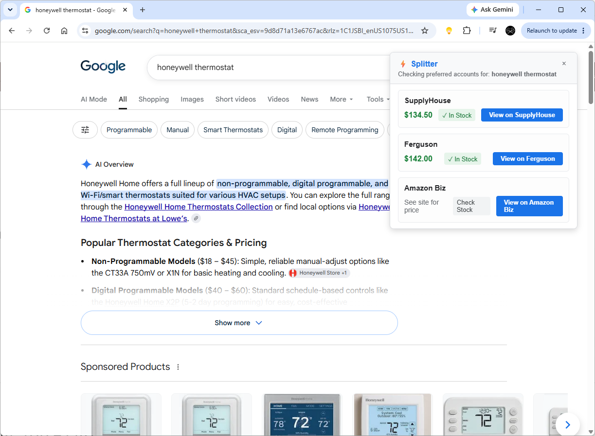

# Splitter B2B Search Interceptor (Prototype)

Splitter is an experimental Chrome Extension prototype designed to intercept B2B procurement searches (e.g., on Google) and instantly display price and stock comparisons across a contractor's preferred suppliers (SupplyHouse, Ferguson, etc.).

## 🚀 The Core Concept
The goal is to save estimators and back-office purchasers time by "piggybacking" their existing active sessions on supplier websites, finding the best price locally without forcing them to change their workflow (i.e., they just search Google as normal).

## ✅ What Works (The UI / UX Shell)
*   **Search Interception:** Successfully reads the user's search query directly from Google (and can be expanded to Bing, DuckDuckGo, etc.).
*   **Decoupled Floating UI:** The comparison widget is injected as a fixed, floating overlay (position: fixed). This makes it 100% immune to Google's frequent DOM layout changes and A/B tests.
*   **Dynamic Custom Suppliers:** The extension popup includes a feature to add *any* regional supplier dynamically. The user searches on a local site, opens the popup, and the extension parses and saves the URL search pattern to local Chrome storage.

## ❌ What Doesn't Work (The Data Engine)
*   **Live Price Scraping is MOCKED:** The prices and stock levels you see are currently hardcoded dummy data.
*   **Cloudflare Bot Protection:** Our initial tests proved that running a raw etch() from a background service worker to SupplyHouse is blocked by Cloudflare (403 Forbidden). 
*   **Session Piggybacking:** Because the automated requests are blocked, the extension cannot currently leverage the user's active login cookies to get accurate pricing tiers.

## 💡 Future Ideas & Architecture
To turn this prototype into a production-ready product, we need to bypass Cloudflare and parse the real pricing data:
1.  **Schema.org JSON-LD Extraction:** Rather than writing brittle HTML scrapers for every regional supplier, the production app should look for invisible pplication/ld+json Schema metadata. 95% of modern e-commerce sites (Shopify, Magento, WooCommerce) inject this universally for Google Shopping, making our extractor infinitely scalable.
2.  **Offscreen API / Backend Engine:** To bypass Cloudflare, the extension could utilize Chrome's Offscreen API to load the supplier's page in a hidden DOM context, executing the scrape as a "real" user. Alternatively, a dedicated backend server with residential proxies is required.
3.  **Cross-Platform Expansion:** Port the concept to a standalone mobile PWA (splitter.com) for field techs in trucks who cannot use desktop browser extensions.

## 🛠️ Installation for Development
1. Clone this repository.
2. Open Chrome and go to chrome://extensions/.
3. Enable "Developer mode" in the top right.
4. Click "Load unpacked" and select the xtension folder in this repository.
